# Guide visuel de soutenance — coloriage de graphes

**Cours accéléré et playbook de défense pour Zied Chouk, Chayma Hakouna et Wirak**

Ce guide part des bases et suit le dépôt réel. Les lignes de code renvoient à `src/coloring.c` tel qu’il est suivi ici. Les temps et ratios viennent de `results/performance_summary.csv`; ils décrivent une campagne sur une machine donnée et ne sont pas des garanties.

## Carte du guide

1. [Comprendre le problème](#1--les-fondamentaux)
2. [Suivre les algorithmes à la main](#2--parcours-visuel-des-algorithmes)
3. [Comprendre le parallélisme OpenMP](#3--openmp-du-débutant-au-code)
4. [Retrouver chaque élément dans le C](#4--carte-du-code-source)
5. [Lire les figures et les tableaux](#5--lire-les-figures-et-les-tableaux)
6. [Présenter à trois et répondre au jury](#6--playbook-de-défense)

## 1 — Les fondamentaux

### 1.1 Un graphe, c’est quoi ?

Un graphe non orienté s’écrit $G=(V,E)$ : `V` est l’ensemble des sommets, `E` l’ensemble des arêtes. Dans notre application, un sommet représente un objet à planifier; une arête dit que deux objets sont incompatibles. Une couleur est une catégorie ou un créneau attribué à l’objet.

```text
Exemple : trois examens qui se chevauchent

    Algo ───── Bases de données
      \             /
       \           /
        Systèmes d'exploitation

Les trois paires sont incompatibles : il faut trois couleurs différentes.
```

Une **coloration propre** donne une couleur à chaque sommet et respecte toutes les arêtes : si `{u,v} ∈ E`, alors `couleur[u] ≠ couleur[v]`. Une coloration est **optimale** si elle est propre et utilise le moins de couleurs possible. Ce minimum s’appelle le **nombre chromatique** `χ(G)`.

Une coloration propre prouve seulement qu’il suffit d’autant de couleurs. Pour prouver que le nombre est minimal, il faut aussi établir qu’aucun coloriage avec moins de couleurs n’existe.

### 1.2 Matrice d’adjacence et mémoire

Le projet stocke la matrice d’adjacence dans un bloc contigu de `uint8_t`. Une case vaut `1` si deux sommets sont reliés, `0` sinon. La ligne du sommet `v`, colonne `u`, se trouve à l’indice `A[v * n + u]`.

```text
Matrice 4 × 4, rangée dans une seule bande mémoire :

       colonne u →  0  1  2  3
ligne v = 0          0  1  0  0   indices  0  1  2  3
ligne v = 1          1  0  1  0           4  5  6  7
ligne v = 2          0  1  0  1           8  9 10 11
ligne v = 3          0  0  1  0          12 13 14 15

A[2 * 4 + 3] = A[11] = 1  ⇔  v₂ et v₃ sont voisins.
Pour un graphe non orienté, A[v*n+u] = A[u*n+v]. La diagonale vaut 0.
```

Cette représentation rend simples les tests d’adjacence, mais elle occupe `n²` octets et un balayage complet d’une ligne examine `n` cases, même si le graphe est peu dense. Le fichier d’entrée contient `n`, puis exactement `n²` chiffres `0` ou `1`; les espaces et retours à la ligne servent seulement de séparateurs. Les sommets sont numérotés dans l’ordre des lignes, de `0` à `n−1` en mémoire.

### 1.3 Heuristique et preuve d’optimalité

| Approche | Ce qu’elle promet | Idée de calcul | Ce qu’il faut retenir |
| --- | --- | --- | --- |
| Glouton (`greedy-*`) | Une coloration propre rapidement | Pour chaque sommet, choisir la plus petite couleur absente chez ses voisins déjà coloriés | C’est une heuristique. Elle donne une borne supérieure `K_glouton ≥ χ(G)`, pas une preuve que la borne est minimale. Avec la matrice du projet, le coût est `Θ(n²)`. |
| Exacte (`exact-*`) | Une coloration optimale ou une décision exacte pour `K` | Essayer une couleur, poursuivre récursivement, revenir en arrière en cas de conflit | L’arbre de recherche peut être exponentiel. Une borne de pire cas pour décider la `K`-colorabilité est `O(n Kⁿ)` avec les contrôles de conflit matriciels. |

Le problème de décision « existe-t-il une coloration propre avec au plus 3 couleurs ? » est NP-complet pour les graphes généraux. Il est dans NP parce qu’une liste de couleurs se vérifie en temps polynomial. Sa NP-difficulté est établie par une réduction polynomiale depuis 3-SAT, au moyen de gadgets qui encodent les variables et les clauses en contraintes de couleur. La preuve complète de la réduction est un résultat théorique; notre backtracking ne la prouve pas, il résout les instances du projet. Trouver une coloration, ou prouver qu’aucune n’existe, peut demander d’explorer énormément de choix. Cela n’affirme pas que chaque entrée est lente : la structure du graphe et l’ordre d’exploration changent beaucoup le travail.

Dans `solve_chromatic`, le glouton donne une borne supérieure valide. Le solveur tente ensuite `K=1,2,…` jusqu’au premier succès. Puisque les valeurs sont testées dans l’ordre, le premier succès est optimal et certifie `χ(G)`.

### 1.4 Exemple 1 : le cycle impair `C₅`

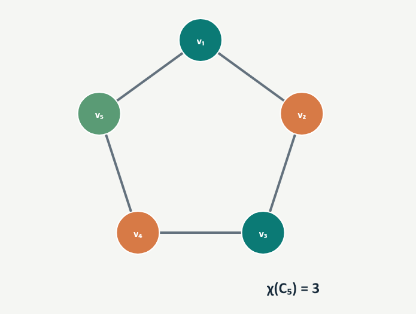

Le cycle relie `v₁–v₂–v₃–v₄–v₅–v₁`. Deux couleurs alternent le long d’un chemin, mais le dernier sommet est voisin à la fois de `v₁` et de `v₄`; il ne peut reprendre aucune des deux. Trois couleurs suffisent, donc `χ(C₅)=3`.

La démonstration montre les deux faits nécessaires : l’image fournit une coloration valide en trois couleurs; le cycle impair ne peut pas être biparti, donc deux couleurs ne suffisent pas.

### 1.5 Exemple 2 : construire un emploi du temps

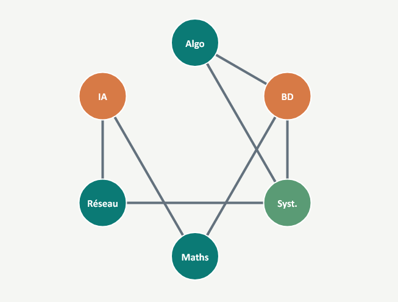

Les sommets représentent Algorithmique, Bases de données, Systèmes d’exploitation, Mathématiques, Réseaux et Intelligence artificielle. Une arête signifie qu’au moins un étudiant suit les deux examens; les deux examens ne peuvent donc pas partager le même créneau. Une couleur regroupe les examens compatibles. Le triangle Algorithmique–Bases de données–Systèmes d’exploitation montre immédiatement qu’il faut au moins trois créneaux. Les couleurs de la figure donnent un planning réalisable en trois créneaux.

## 2 — Parcours visuel des algorithmes

### 2.1 Glouton séquentiel : la trace `forbidden` sur `C₅`

Le glouton visite les sommets dans l’ordre du fichier. À chaque étape, il repère les couleurs déjà prises par les voisins coloriés, puis choisit la première couleur non interdite. `forbidden[c]` représente cette liste.

| Sommet courant | Voisins déjà coloriés | Couleurs interdites | `forbidden[1..5]` | Choix |
| --- | --- | --- | --- | --- |
| `v₁` | aucun | aucune | `[0,0,0,0,0]` | 1 |
| `v₂` | `v₁(1)` | `{1}` | `[1,0,0,0,0]` | 2 |
| `v₃` | `v₂(2)` | `{2}` | `[0,1,0,0,0]` | 1 |
| `v₄` | `v₃(1)` | `{1}` | `[1,0,0,0,0]` | 2 |
| `v₅` | `v₁(1)`, `v₄(2)` | `{1,2}` | `[1,1,0,0,0]` | 3 |

Résultat : `[1,2,1,2,3]`. La validité est garantie par le choix parmi les couleurs libres; l’optimalité ne l’est pas en général. Sur `C₅`, le résultat du glouton est optimal, mais c’est la preuve « deux couleurs impossibles » qui le certifie.

### 2.2 Backtracking : essayer, avancer, annuler

Pour un `K` fixé, le programme traite le prochain sommet. Il essaie une couleur de `1` à `K`; si aucun voisin déjà colorié n’a cette couleur, il l’affecte et passe au sommet suivant. Si la suite échoue, il remet `couleurs[v] = 0` : c’est le retour en arrière.

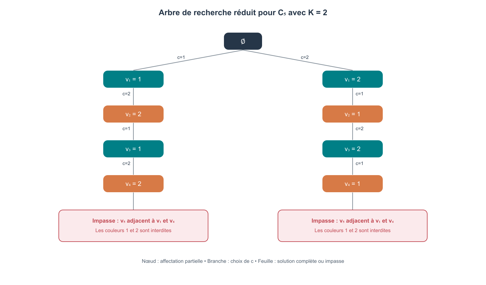

L’arbre montre les deux choix possibles pour `v₁`. Avec `K=2`, les quatre premiers sommets alternent nécessairement `1,2,1,2` (ou `2,1,2,1`). `v₅`, adjacent à `v₁` et `v₄`, ne peut prendre ni 1 ni 2 : les deux branches meurent.

```text
TROUVER_NOMBRE_CHROMATIQUE(G)
  K_glouton ← nombre de couleurs produit par le glouton
  pour K = 1, 2, …, K_glouton :
      si RECHERCHE(G, sommet 0, K) réussit :
          retourner K et la coloration

RECHERCHE(G, v, K)
  si v = n : toutes les affectations sont valides → succès
  pour c = 1, 2, …, K :
      si c est sûre pour v :
          couleur[v] ← c
          si RECHERCHE(G, v+1, K) réussit : garder c et remonter le succès
          couleur[v] ← 0          ← annuler ce choix après un échec
  retourner échec
```

Le flot propre au calcul du nombre chromatique est :

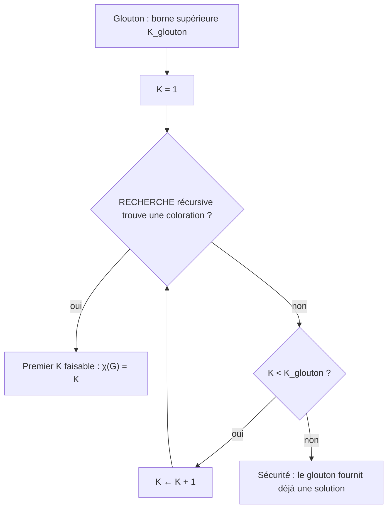

Sur `C₅`, `K=1` échoue, `K=2` échoue au dernier sommet, et `K=3` réussit. L’algorithme s’arrête alors : `χ(C₅)=3`.

## 3 — OpenMP du débutant au code

### 3.1 Les quatre constructions de base

| Directive | Image mentale | Usage dans ce dépôt |
| --- | --- | --- |
| `#pragma omp parallel` | Former une équipe de threads | Crée la région parallèle; chaque thread exécute son bloc. |
| `#pragma omp single` | Un seul membre fait une étape commune | Un thread efface `forbidden` ou choisit la couleur. Par défaut, les autres attendent à la barrière implicite à la fin du `single`. |
| `#pragma omp for` | Découper les tours d’une boucle entre l’équipe | Répartit les colonnes `u` examinées pour un sommet courant (`schedule(static)`). Il y a une barrière implicite à la fin de la boucle. |
| `#pragma omp task` | Mettre une branche de recherche dans le pool de tâches | Les choix de couleur indépendants deviennent du travail que l’équipe peut prendre. |

`firstprivate` initialise une variable privée avec la valeur qu’elle avait au moment où la tâche est créée. Ici, `child` est un pointeur; `firstprivate(child)` copie la valeur du pointeur. Le tableau visé est, lui, une allocation unique créée et remplie par `malloc`/`memcpy` pour cette branche. Chaque tâche reçoit donc un pointeur différent vers son propre état de couleurs; `firstprivate` ne fait pas à lui seul une copie profonde du tableau.

### 3.2 Chronologie du glouton OpenMP

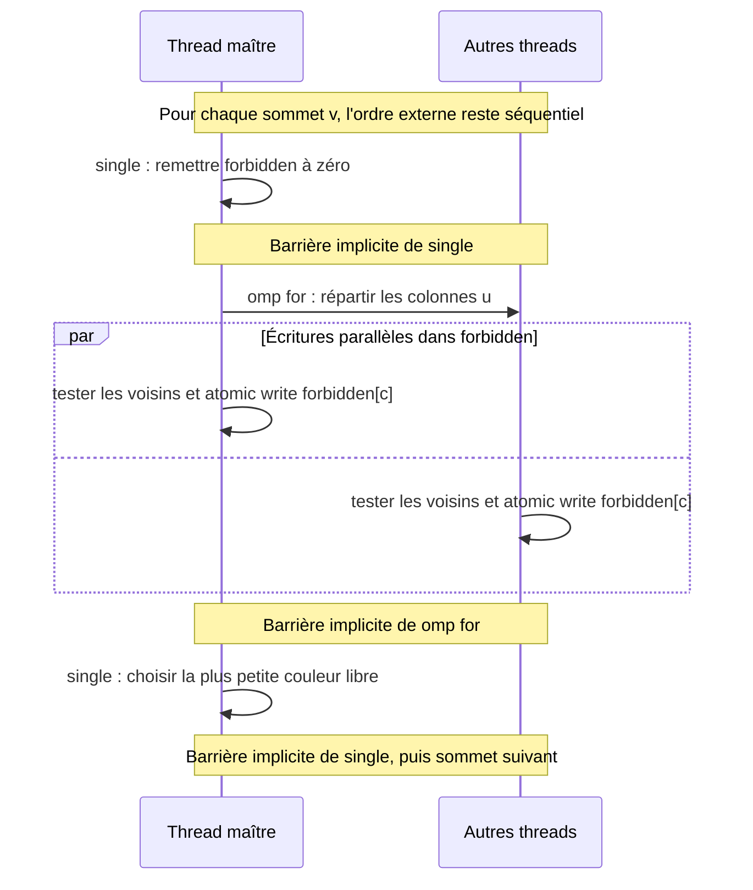

Le choix de la couleur de `v` dépend des sommets précédents; cette boucle externe reste donc séquentielle. Seul le balayage de la ligne est distribué. Les threads peuvent interdire la même couleur en même temps : `atomic write` protège ces écritures. La barrière de `omp for` assure que toutes les interdictions sont visibles avant la lecture du tableau.

Trois constructions de la boucle ont chacune une barrière implicite (`single`, `for`, `single`). Sur `G12000`, cela représente `3 × 12 000 = 36 000` passages de barrière. Cette organisation est pédagogique et correcte, mais elle coûte cher quand chaque étape de sommet est courte.

### 3.3 Chronologie du backtracking parallèle

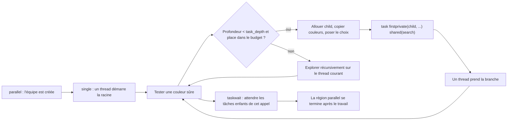

`task_depth` limite la création de tâches (défaut 4, maximum 4 dans le CLI). Au-delà, la récursion continue sans créer de tâche supplémentaire. Une limite de 8 192 identifiants empêche aussi une création sans borne; les branches restantes sont calculées sur le thread courant.

`taskwait` attend les tâches enfants créées par l’appel courant. Les fonctions de recherche appelées dans ces tâches attendent elles-mêmes leurs propres enfants avant de finir : le sous-arbre est donc terminé quand la tâche parente se termine. `taskwait` règle le moment où le calcul peut continuer; il ne protège pas à lui seul un accès partagé concurrent.

### 3.4 Partage sûr de la solution

Le solveur parallèle partage le graphe en lecture seule, le drapeau entier `solution_found`, et le tampon de solution gagnante. Il garde un tableau `couleurs` privé à chaque branche.

```text
Branche A : couleurs ── copie A ── tâche A
Branche B : couleurs ── copie B ── tâche B
                                     │
                                     └── solution_found (partagé)
                                         solution (partagée, un seul gagnant)
```

- `atomic read` et `atomic write` rendent les lectures et écritures simples de `solution_found` atomiques. Une tâche qui voit `1` peut arrêter tôt.
- `critical(solution_copy)` protège la séquence complète qui vérifie le drapeau puis copie le tableau `solution`. `atomic` seul ne protégerait pas la copie de plusieurs entiers.
- L’écriture atomique du drapeau publie qu’une solution a été déposée. Les autres branches ne modifient pas le tampon gagnant.
- `critical(task_budget)` protège le compteur qui attribue les identifiants de tâches.

En résumé : `atomic` rend sûr un accès simple; `critical` rend exclusive une petite séquence; `taskwait` attend du travail. Ce sont trois responsabilités différentes.

### 3.5 Pourquoi l’OpenMP aide l’exact et pénalise le glouton

Sur les graphes exacts, une branche peut être très longue et les sous-arbres explorables sont indépendants si chacun a son propre vecteur de couleurs. Sur les instances mesurées `G20` à `G36`, ce travail fournit assez de calcul pour amortir la création des tâches, surtout pour G30 et G36. Les résultats dépendent toutefois de la difficulté de l’arbre et de l’ordonnancement.

Sur `G12000`, le glouton séquentiel prend environ `0,159 s`; le mode OpenMP à quatre threads prend environ `1,207 s`. Cette instance contient `7 194 563` arêtes, et le balayage visite chaque arête une fois du côté du sommet courant, d’où environ 7,19 millions d’écritures atomiques dans `forbidden`. Les 36 000 passages de barrière s’ajoutent aux créations de région, aux atomiques et aux attentes. Le travail parallèle par sommet ne compense pas ces coûts.

L’exact OpenMP de `G20` passe d’environ `6,76 ms` en séquentiel à `1,66 ms` à quatre threads dans la campagne archivée : `S(4) ≈ 4,07`. Cette accélération superlinéaire observée n’est pas une promesse de matériel : l’ordre concurrent des branches peut trouver une solution plus tôt que l’ordre séquentiel, et les petits temps sont sensibles au bruit. Sur G30 et G36, les gros sous-arbres donnent aussi des gains à plusieurs threads, sans garantir une accélération idéale.

## 4 — Carte du code source

Les numéros ci-dessous sont ceux de la version actuelle de `src/coloring.c`. Les intitulés de « critère » sont des repères pédagogiques — modèle/correction, complexité, calcul parallèle, expérimentation — et non des numéros de barème officiel.

### 4.1 Types et constantes

| Élément | Lignes | Champs / rôle | Repère d’évaluation |
| --- | --- | --- | --- |
| Constantes | 13–15 | Maximum `20 000` sommets, budget de `8 192` tâches, profondeur par défaut `4`. | Paramètres et limites explicites. |
| `Graph` | 17–21 | Entrée : matrice chargée. Champs : nombre de sommets `n`, d’arêtes `m`, pointeur `adj`. `adj` contient `n²` octets. | Modélisation, représentation et mémoire. |
| `TraceEvent` | 23–29 | Identifiant, niveau, thread, début et fin relatifs d’une tâche suivie. | Protocole expérimental et visualisation Gantt. |
| `ParallelSearch` | 31–43 | État partagé de recherche : graphe, `k`, solution, drapeau, profondeur, budget, événements et erreur. | Calcul parallèle et gestion des tâches. |
| `SolveResult` | 45–50 | Résultat du CLI : nombre de couleurs, faisabilité d’un `k`, mode décision et tableau de couleurs. | Résultat et contrat d’interface. |

### 4.2 Fonctions : entrées, sorties et objectif

| Fonction | Lignes | Entrée → sortie | Pourquoi elle existe |
| --- | --- | --- | --- |
| `set_error` | 52–56 | Message + tampon → aucun retour; copie le message si le tampon existe. | Erreurs compréhensibles et chemins de validation. |
| `graph_load` | 58–138 | Chemin → `Graph` rempli ou échec + message. Vérifie le format, les limites, la diagonale et la symétrie; compte les arêtes. | Modèle valide avant tout calcul; représentation matricielle. |
| `graph_free` | 140–145 | `Graph*` → libération et structure remise à zéro. | Cycle de vie mémoire. |
| `coloring_is_valid` | 147–162 | Graphe, couleurs, nombre annoncé → booléen. Vérifie les bornes et les arêtes. | Vérification indépendante du résultat rendu. |
| `greedy_sequential` | 164–193 | Graphe → couleurs gloutonnes + nombre utilisé; `-1` si allocation impossible. | Heuristique `Θ(n²)` et borne supérieure. |
| `greedy_openmp` | 195–244 | Graphe + nombre de threads → mêmes choix gloutons parallélisés par ligne. | Directives `parallel`, `single`, `for`, `atomic`. |
| `is_safe_color` | 246–253 | Graphe, affectations partielles, sommet, couleur → vrai si aucun voisin colorié ne la prend. | Prune les choix interdits du backtracking. |
| `search_sequential` | 255–269 | Graphe, `K`, sommet courant, tableau mutable → succès ou échec; garde la solution en cas de succès. | Récursion exhaustive, affectation, retour à 0. |
| `decide_sequential` | 271–285 | Graphe + `K` → existence d’une `K`-coloration et tableau. | Prépare un appel à la recherche de décision. |
| `atomic_solution_found` | 287–293 | État partagé → lecture atomique du drapeau. | Arrêt anticipé sans lecture concurrente ordinaire. |
| `reserve_task_id` | 295–305 | État partagé → identifiant ou `-1` si budget atteint. | Protège le compteur avec `critical(task_budget)`. |
| `publish_solution` | 307–320 | État partagé + couleurs locales → publication du premier résultat. | `critical` protège la copie; `atomic` publie le drapeau. |
| `run_task_branch` | 324–341 | Branche allouée + sommet/profondeur/id → calcule et libère la copie; enregistre les temps si Gantt. | Encapsule le cycle de vie d’une tâche. |
| `search_parallel` | 343–395 | État partagé + sommet/profondeur + couleurs privées → recherche récursive et tâches. | Décomposition parallèle avec copies indépendantes. |
| `write_gantt_csv` | 397–418 | Chemin + événements → CSV ou erreur. | Sortie des événements de traçage. |
| `decide_parallel` | 420–490 | Graphe, `K`, threads, profondeur, option de trace → faisabilité et solution. | Région `parallel`, racine `single`, attente finale. |
| `solve_chromatic` | 492–529 | Graphe et choix séquentiel/parallèle → `χ(G)` et coloration optimale. | Borne gloutonne puis `K` croissants. |
| `free_result` | 531–534 | `SolveResult*` → libère ses couleurs et remet à zéro. | Cycle de vie du résultat. |
| `solve_once` | 536–576 | Graphe, mode et paramètres → résultat d’un calcul; `--k` pour les modes exacts. | Relie le CLI aux quatre algorithmes. |
| `write_trace_after_solve` | 579–590 | Graphe, `χ`, chemin, threads → relance séparée une décision pour le Gantt. | Sépare le traçage de la mesure chronométrée. Profondeur de trace fixée à 2. |
| `parse_positive_int` | 593–602 | Texte + limites → entier validé ou faux. | Validation des paramètres CLI. |
| `print_usage` | 604–610 | Nom du programme → syntaxe des modes et options sur stderr. | Aide en cas d’arguments manquants/invalides. |
| `main` | 611–778 | `argv` → charge, échauffe, répète, mesure, valide et imprime un JSON; code de retour non nul en cas d’erreur. | Interface, protocole de mesure et résultat exploitable. |

### 4.3 Où poser le doigt pendant la soutenance

```text
Chargement et validation       graph_load                 lignes 58–138
Heuristique séquentielle       greedy_sequential          lignes 164–193
Heuristique OpenMP             greedy_openmp              lignes 195–244
Test de conflit                is_safe_color              lignes 246–253
Retour sur trace séquentiel    search_sequential          lignes 255–269
Publication de solution       publish_solution           lignes 307–320
Création et attente de tâches search_parallel            lignes 343–395
Mesure de χ                    solve_chromatic            lignes 492–529
Options, répétitions, JSON     main                       lignes 611–778
```

Pour le glouton OpenMP, montrez que `v` reste séquentiel et le `omp for` couvre `u`. Pour l’exact parallèle, montrez l’allocation/copie `child` avant la directive `task`, puis les protections atomiques et critiques. Cela rend visible la différence entre paralléliser un balayage dépendant et distribuer des sous-arbres indépendants.

## 5 — Lire les figures et les tableaux

### 5.1 Deux formules à connaître

Pour une même instance et une même configuration de mesure, `T_s` est le temps séquentiel de référence et `T_p` le temps avec `p` threads :

$$S(p)=\frac{T_s}{T_p} \qquad E(p)=\frac{S(p)}{p}$$

- `S(p)=1` : autant de temps que la référence; `S(p)>1` : accélération; `S(p)<1` : ralentissement.
- `E(p)=1` : accélération idéale; `E(p)<1` : une partie du temps est absorbée par le partage, les synchronisations ou les déséquilibres.
- `E(p)>1` peut arriver dans une recherche exacte si l’ordre concurrent trouve plus tôt une solution. C’est une accélération superlinéaire observée, pas une garantie.
- L’axe vertical des graphes de temps et de taille est logarithmique : les distances correspondent à des rapports multiplicatifs, pas à des différences constantes.

### 5.2 Figures de structure et d’illustration

#### Cycle `C₅`


> **Lecture / 30 secondes au jury :** « Chaque arête relie deux couleurs différentes. Le cycle est impair, donc deux couleurs ne suffisent pas; cette coloration en trois couleurs est optimale : `χ(C₅)=3`. »

#### Arbre de recherche de `C₅`, `K=2`


> **Lecture / 30 secondes au jury :** « Les deux premières branches fixent la couleur de `v₁`. Dans chaque branche, l’alternance impose les couleurs des quatre premiers sommets. `v₅` touche `v₁` et `v₄`, donc ses deux couleurs sont interdites; cela prouve que `C₅` n’est pas 2-coloriable. »

#### Emploi du temps


> **Lecture / 30 secondes au jury :** « Un sommet est un examen et une arête est un conflit d’étudiants. Une même couleur signifie un même créneau. Le triangle visible impose au moins trois créneaux; le coloriage donne un planning réalisable en trois. »

### 5.3 Temps, accélération et efficacité

#### Temps du glouton par nombre de threads

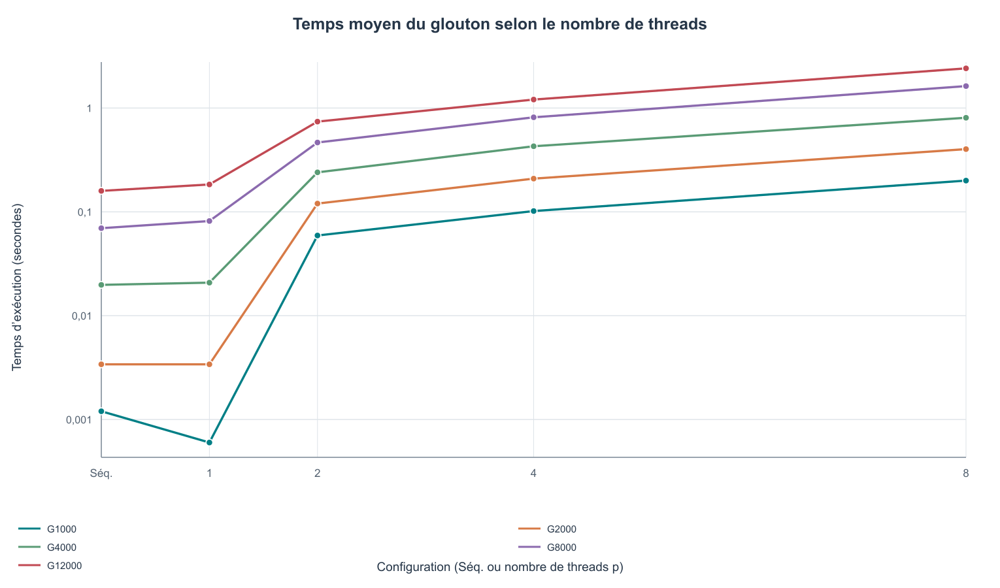

> **Lecture / 30 secondes au jury :** « L’axe vertical logarithmique compare le glouton séquentiel et OpenMP à 1, 2, 4 et 8 threads pour cinq tailles. Quand on augmente le nombre de threads, les courbes OpenMP montent sur ces graphes : le coût des barrières et atomiques dépasse le travail réparti. »

#### Temps du backtracking par nombre de threads

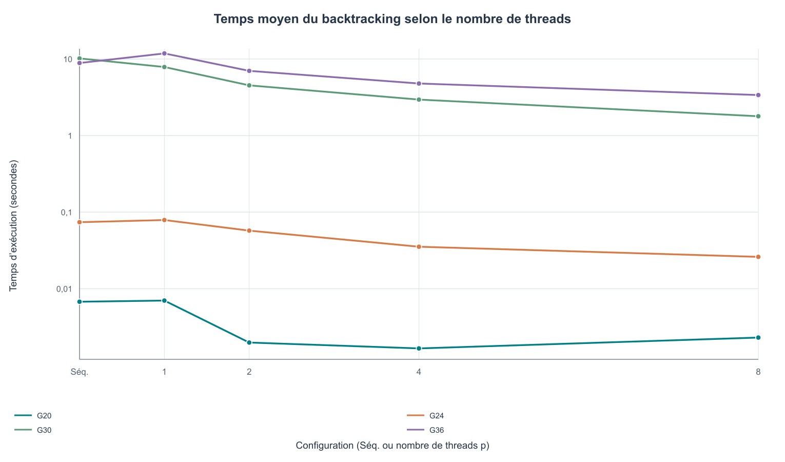

> **Lecture / 30 secondes au jury :** « Chaque courbe correspond à une instance exacte, les points aux nombres de threads. Les grandes instances G30 et G36 diminuent nettement avec plusieurs threads; G20 est déjà si court que le bruit de mesure est visible. La difficulté dépend de l’arbre, pas seulement de `n`. »

#### Accélération du glouton

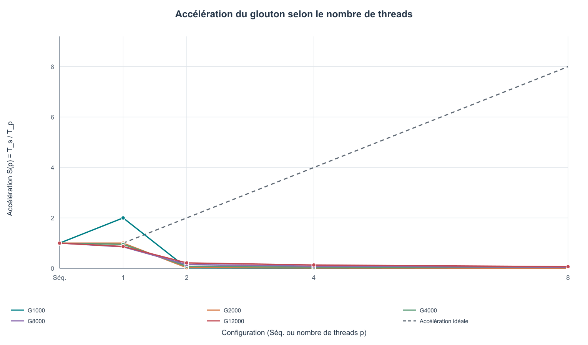

> **Lecture / 30 secondes au jury :** « La ligne pointillée est l’idéal `S(p)=p`. Les courbes du glouton restent près de 1 à un thread puis s’effondrent dès deux threads. À G12000, quatre threads donnent environ `0,132×` : l’OpenMP est environ 7,6 fois plus lent que le séquentiel. »

#### Accélération du backtracking

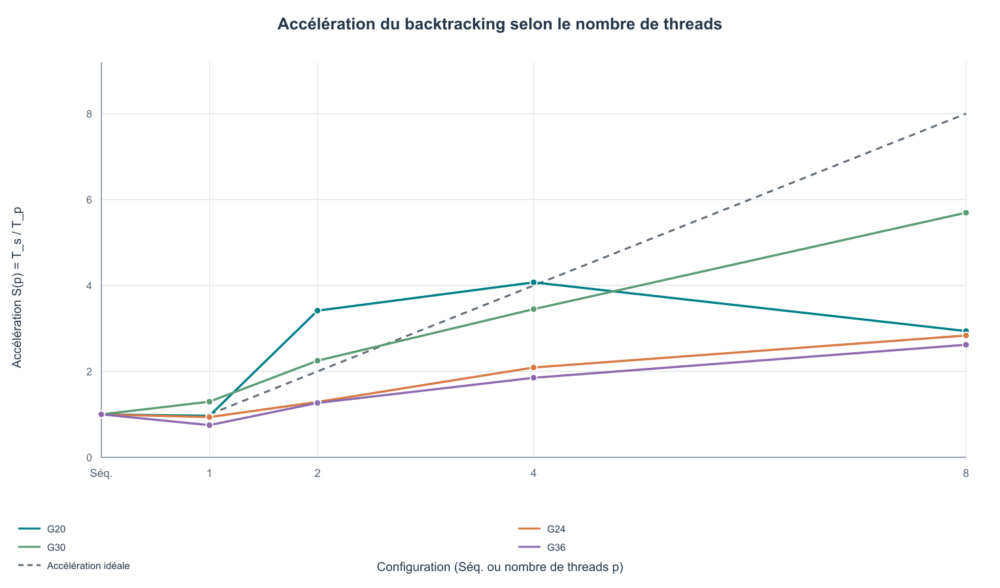

> **Lecture / 30 secondes au jury :** « Comparez les courbes à la diagonale idéale. Pour G20, `T_s≈6,76 ms` et `T_4≈1,66 ms`, donc `S(4)≈4,07`. G30 atteint environ 5,69× à huit threads. L’effet dépend de la structure des sous-arbres et de leur ordre d’exploration. »

#### Efficacité du glouton

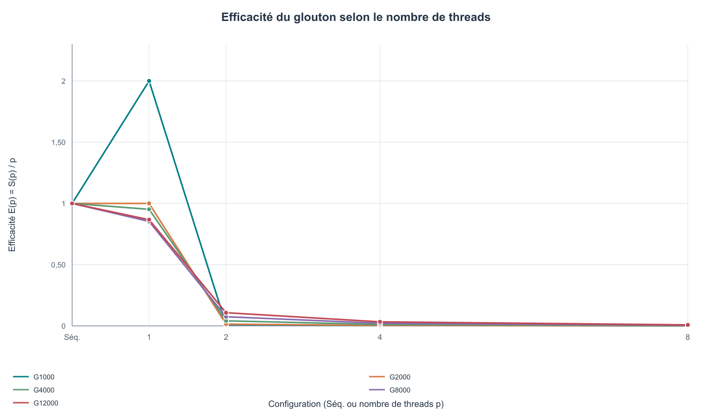

> **Lecture / 30 secondes au jury :** « L’efficacité divise le speedup par le nombre de threads. Pour le glouton, elle devient presque nulle à deux threads et plus : l’équipe attend ou synchronise plus qu’elle ne gagne en travail utile. Le point G1000 à un thread est instable car les durées sont proches de la résolution du chronomètre. »

#### Efficacité du backtracking

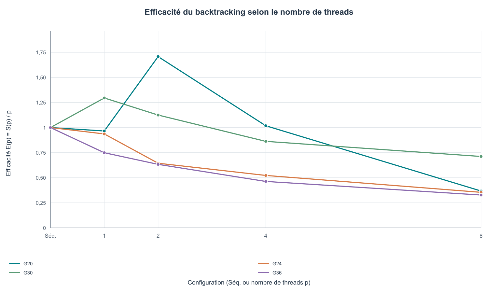

> **Lecture / 30 secondes au jury :** « G20 dépasse momentanément 1 à deux threads, et reste juste au-dessus de 1 à quatre : c’est cohérent avec `S(4)≈4,07`. G30 et G36 restent sous l’idéal; leurs sous-arbres n’ont pas tous la même durée et les tâches ont un coût. »

### 5.4 Évolution avec la taille des graphes

#### Glouton selon `n`

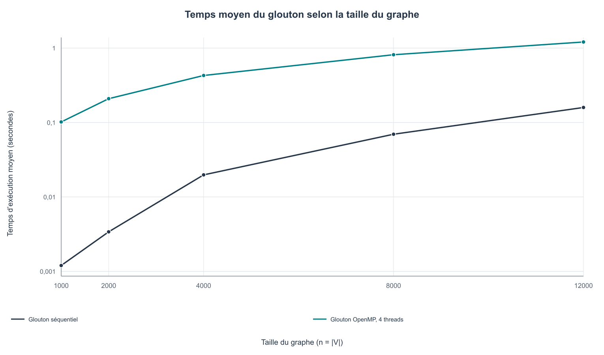

> **Lecture / 30 secondes au jury :** « Les deux courbes augmentent quand `n` grandit; l’axe logarithmique aide à comparer les ordres de grandeur. La courbe OpenMP à quatre threads est au-dessus du séquentiel. La tendance est compatible avec les balayages matriciels, mais ce graphique ne démontre pas à lui seul une borne asymptotique. »

#### Backtracking selon `n`

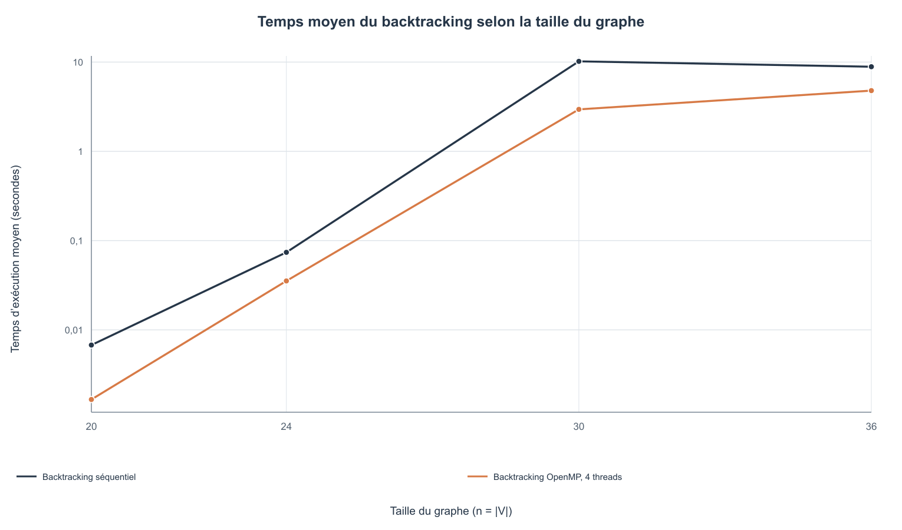

> **Lecture / 30 secondes au jury :** « Les temps montent très vite entre G20 et G30, puis G36 est un peu plus rapide que G30 en séquentiel : environ `8,87 s` contre `10,19 s`. Une taille plus grande n’implique pas un arbre plus difficile; structure, densité et ordre des choix changent l’élagage. »

#### Vue combinée historique des temps

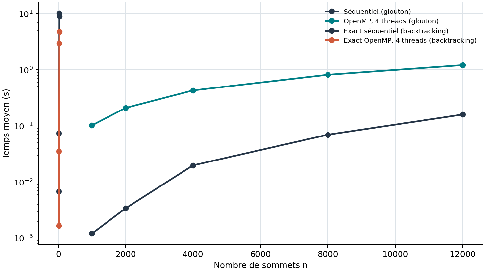

> **Lecture / 30 secondes au jury :** « Cette figure combine plusieurs familles et utilise une échelle logarithmique. Les points des séries exactes sont regroupés à l’origine de l’axe horizontal dans cette ancienne vue; elle ne permet donc pas de lire une tendance exacte en fonction de `n`. Pour cette comparaison, utilisez `taille_exact.png`, qui place correctement G20, G24, G30 et G36. »

### 5.5 Traces Gantt OpenMP

Dans un Gantt, l’axe horizontal est le temps; chaque ligne est un thread; chaque rectangle turquoise est une tâche feuille journalisée de profondeur 2. Le gris signifie « aucune tâche feuille journalisée à cet instant », y compris une attente possible. Ce n’est pas un compteur d’utilisation CPU : le traçage ne représente pas chaque instruction ni tout le travail récursif.

#### Vue Gantt synthétique à quatre threads

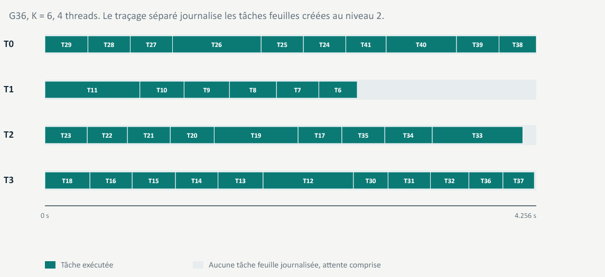

> **Lecture / 30 secondes au jury :** « Les tâches ne sont pas de longueur égale. Certains threads ont des plages grises alors que d’autres continuent : les sous-arbres sont déséquilibrés. La trace est prise à part, car l’instrumentation ne doit pas fausser les temps du benchmark. »

#### Gantt de G36 à deux threads

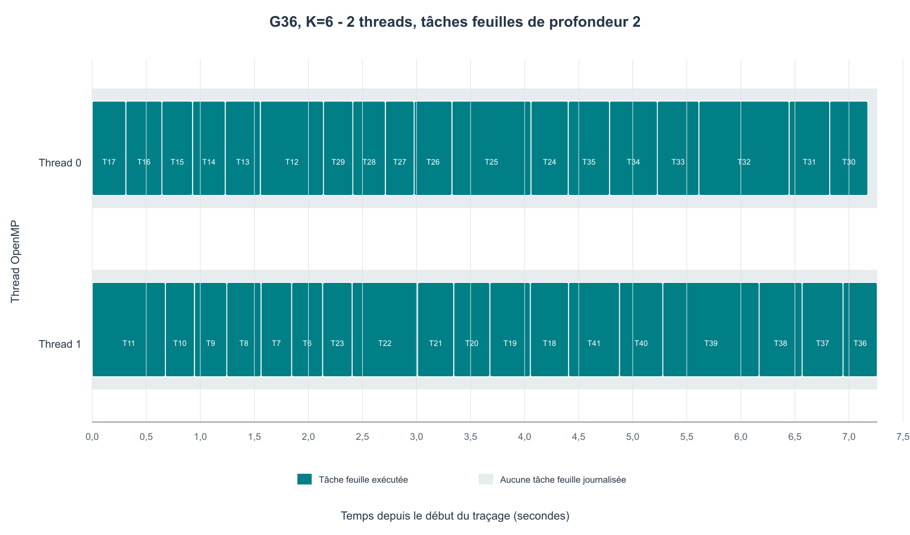

> **Lecture / 30 secondes au jury :** « Chaque ligne suit un thread pendant la recherche de G36 avec `K=6`. Les deux threads reçoivent du travail sur la majeure partie des quelque 7,26 secondes de trace, mais les frontières des tâches montrent des durées différentes. »

#### Gantt de G36 à quatre threads

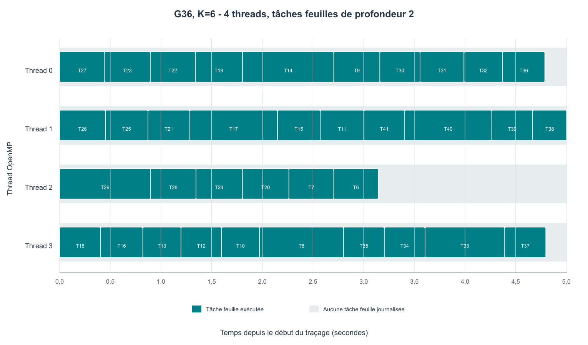

> **Lecture / 30 secondes au jury :** « Quatre lignes partagent ici les tâches feuilles; la trace couvre environ 5,00 secondes. Les threads 0, 1 et 3 restent occupés plus longtemps que le thread 2, qui finit vers 3,1 secondes et présente ensuite une plage grise. C’est un déséquilibre de charge visible; le gris ne prouve pas que le cœur est inactif. »

Les figures Gantt viennent de résolutions séparées avec profondeur 2 et des ordonnancements distincts. Elles illustrent l’équilibrage; ne les utilisez pas pour recalculer `S(p)` à partir des temps du benchmark.

### 5.6 Lire les tableaux du rapport

Le rapport contient huit tableaux. Pour les tableaux de performance, `results/performance_summary.csv` est la source : les colonnes essentielles sont `mean_seconds`, `stdev_seconds`, `speedup_vs_sequential`, `efficiency` et `chromatic_number`. `raw_measurements.csv` conserve les répétitions; la moyenne résume, l’écart-type indique leur dispersion.

| Tableau du rapport | Ce qu’il contient | Comment le commenter |
| --- | --- | --- |
| 1 — Trace gloutonne sur C₅ | Sommet, couleurs interdites, couleur choisie. | Lire la dernière ligne : `v₅` voit les couleurs 1 et 2, donc prend 3. |
| 2 — Trace d’une branche de backtracking | Affectations `v₁` à `v₄`, puis échec de `v₅` avec `K=2`. | Une branche montre l’impasse; l’arbre de recherche montre que l’autre branche échoue aussi. |
| 3 — Travail et synchronisation des quatre versions | Glouton/exact, séquentiel/OpenMP, travail partagé et directives. | Mettre en contraste le balayage de ligne du glouton et les sous-arbres indépendants de l’exact. |
| 4 — Complexités temporelles et spatiales | Meilleur, moyen, pire cas et espace auxiliaire. | Dire que le cas moyen est mesuré sur la famille choisie; ce n’est pas une formule universelle. La matrice occupe `Θ(n²)`. |
| 5 — Phases du projet | Analyse, versions séquentielles, parallélisation, expériences et synthèse. | Suivre le lien entre spécification, solution, mesure puis interprétation. |
| 6 — Temps, speedup et efficacité du glouton | Pour G1000–G12000, temps moyen ± σ, `S(p)`, `E(p)` et `K_glouton`. | À partir de deux threads, le glouton OpenMP ralentit; le nombre de couleurs reste la qualité heuristique. |
| 7 — Temps, speedup et efficacité du backtracking | Pour G20–G36, mêmes mesures et `χ(G)`. | Vérifier d’abord que `χ(G)` reste le même entre modes; comparer ensuite S et E, en tenant compte de la variabilité. |
| 8 — Exemples d’applications | Domaine, sommets, arêtes et couleurs. | Le modèle garde le même sens abstrait; seule l’interprétation concrète change. |

Pour les tableaux 6 et 7, les lignes `Séquentiel` définissent la référence `S=1`, `E=1`. Les lignes OpenMP à `p=1,2,4,8` indiquent le temps moyen ± écart-type; `n. m.` signifie qu’une configuration n’a pas été mesurée. Le nombre de couleurs (ou `χ(G)`) permet de vérifier que l’on compare bien une qualité de solution cohérente.

| Instance / observation archivée | Séquentiel | OpenMP | Commentaire oral |
| --- | ---: | ---: | --- |
| G20, exact, 4 threads | 6,76 ms | 1,66 ms | `S(4)≈4,07`, accélération superlinéaire observée sur cette petite instance. |
| G30, exact, séquentiel | 10,19 s | — | Plus long que G36, malgré moins de sommets. |
| G36, exact, séquentiel | 8,87 s | — | Arbre de recherche différent; `n` seul ne prédit pas le temps. |
| G12000, glouton, 4 threads | 0,159 s | 1,207 s | Environ 7,6 fois plus lent en OpenMP; synchronisations dominantes. |

Les mesures sont des moyennes par résolution. Pour les modes exacts, `chromatic_number` doit rester identique en séquentiel et en parallèle; les tableaux de couleurs peuvent différer. Ne comparez des temps que pour la même instance, le même mode et le même protocole. Présentez les nombres comme observations de la campagne, pas comme performances universelles.

## 6 — Playbook de défense

### 6.1 Script oral équilibré, diapositive par diapositive

La répartition ci-dessous vise **4 minutes de parole par personne** pour les diapositives (12 minutes au total). Les transitions et la démo terminale de 90 secondes sont partagées séparément. Les textes entre guillemets sont des phrases d’appui : dites-les naturellement, en pointant la figure ou la partie de code pertinente.

#### Zied — problème et méthodes séquentielles, 4 minutes

| Diapo | Temps cible | Script à dire |
| --- | ---: | --- |
| 1 — Le coloriage de graphes | 20 s | « Nous présentons le coloriage de graphes, deux algorithmes, leurs versions OpenMP et une comparaison expérimentale. Nous sommes Zied Chouk, Chayma Hakouna et Wirak. » |
| 2 — Colorier sous contraintes | 55 s | « Un sommet représente un objet et une arête une incompatibilité. Deux sommets reliés ne peuvent pas partager une couleur. L’objectif pratique est un planning valide; l’objectif mathématique est de minimiser les couleurs. » |
| 3 — Exemple théorique : C₅ | 55 s | « Dans ce cycle impair, deux couleurs alternent jusqu’au dernier sommet, qui est adjacent aux deux extrémités déjà colorées. Il faut donc une troisième couleur; `χ(C₅)=3`. » |
| 4 — Trace gloutonne sur C₅ | 60 s | « Le glouton parcourt les sommets dans l’ordre et choisit la première couleur absente chez les voisins déjà traités. La dernière ligne de la trace interdit 1 et 2, donc choisit 3. Le glouton donne une borne supérieure, pas toujours l’optimum. » |
| 5 — Méthode gloutonne | 50 s | « Pour chaque sommet, on marque les couleurs de ses voisins antérieurs, puis on prend la première libre. Avec la matrice, on lit une ligne de n cases pour chacun des n sommets : `Θ(n²)`. » |

#### Chayma — exact, complexité et OpenMP, 4 minutes

| Diapo | Temps cible | Script à dire |
| --- | ---: | --- |
| 6 — Retour sur trace | 45 s | « Le backtracking fait un choix, avance, et remet la couleur à zéro quand la branche échoue. Sur C₅ avec K=2, les deux branches mènent au conflit de `v₅`. » |
| 7 — Complexité avec matrice d’adjacence | 50 s | « Le glouton est quadratique avec cette représentation. La recherche exacte peut explorer jusqu’à un arbre exponentiel; une instance facile ne change pas sa borne de pire cas. » |
| 8 — Glouton OpenMP | 50 s | « L’ordre des sommets est dépendant, donc on ne répartit pas cette boucle. On répartit les colonnes de la ligne courante, puis on synchronise avant le choix de couleur. Sur G12000, les barrières et écritures atomiques coûtent plus que le travail gagné. » |
| 9 — Backtracking parallèle avec tâches | 65 s | « Les branches d’un arbre de recherche sont des unités de travail indépendantes si elles ont des vecteurs de couleurs distincts. On crée ces copies, OpenMP distribue les tâches, et le premier résultat est publié avec une copie protégée. » |
| 10 — Application réelle : emploi du temps | 30 s | « La même modélisation s’applique à six examens. Une arête interdit un même créneau; une couleur définit un groupe d’examens simultanés. Le triangle impose trois créneaux. » |

#### Wirak — protocole, résultats et conclusion, 4 minutes

| Diapo | Temps cible | Script à dire |
| --- | ---: | --- |
| 11 — Protocole expérimental | 35 s | « Les graphes sont déterministes, produits avec des graines fixées. Nous mesurons plusieurs tailles et 1, 2, 4 et 8 threads; les répétitions donnent une moyenne et une dispersion. » |
| 12 — Temps moyen selon le nombre de threads | 35 s | « Voici les durées par configuration. Le glouton ralentit en OpenMP; le backtracking profite davantage des tâches sur les grosses instances. » |
| 13 — Accélération parallèle | 40 s | « `S(p)=T_s/T_p`; la diagonale est l’idéal. G20 atteint environ 4,07 à quatre threads, tandis que G30 atteint environ 5,69 à huit threads. Ce sont des observations dépendantes des instances. » |
| 14 — Efficacité parallèle | 35 s | « L’efficacité divise le speedup par p. Le glouton s’effondre au-delà d’un thread. Une efficacité supérieure à 1 sur G20 vient d’une exploration qui trouve plus tôt la solution et du bruit de mesure. » |
| 15 — Temps selon la taille | 35 s | « En exact, G36 est plus rapide que G30 en séquentiel. La taille ne suffit pas à prévoir la difficulté d’un arbre de recherche. » |
| 16 — Ordonnancement Gantt des tâches | 40 s | « Chaque barre est une tâche feuille journalisée. Les durées varient et les plages grises signalent l’absence de tâche tracée, attente incluse; ce n’est pas une mesure directe de l’activité CPU. » |
| 17 — Applications et conclusion | 20 s | « Le coloriage traduit des conflits en affectations compatibles. Nous retenons que le choix de représentation et la forme du travail déterminent si la parallélisation est utile. Merci; nous sommes prêts pour vos questions. » |

### 6.2 Démo terminale en 90 secondes : trois commandes

Compilez et vérifiez le dépôt avant l’arrivée du jury. G20 est suivi par Git; la démo ne lance ni génération ni benchmark complet. La commande C₅ est très courte; commentez pendant l’affichage puis enchaînez.

**PowerShell — commandes à copier :**

```powershell
.\build\coloring.exe data\examples\cycle5.txt exact-seq
.\build\coloring.exe data\generated\exact\g20.txt exact-seq --warmup 1 --repeat 3 --batch 10
.\build\coloring.exe data\generated\exact\g20.txt exact-omp --threads 4 --task-depth 4 --warmup 1 --repeat 3 --batch 10
```

| Temps indicatif | Qui parle | Ce qu’il faut dire pendant la commande |
| --- | --- | --- |
| 0–25 s — C₅ séquentiel | Zied | « Nous avons cinq sommets et cinq arêtes. Le JSON confirme une coloration valide en trois couleurs, avec le résultat `1,2,1,2,3`. » |
| 25–55 s — G20 séquentiel | Chayma | « G20 contient 20 sommets et 91 arêtes. Le solveur exact certifie cinq couleurs; échauffement et répétitions stabilisent la mesure affichée. » |
| 55–85 s — G20 OpenMP, 4 threads | Wirak | « Même optimum, cette fois avec quatre threads et profondeur de tâches quatre. Comparez `seconds` à la ligne précédente comme une observation de cette machine; l’ordre des couleurs peut différer. » |
| 85–90 s — conclusion | Tous | « Les deux modes exacts rendent une coloration valide en cinq couleurs; l’accélération mesurée varie selon la machine. » |

Sur CMD, utilisez `build\coloring.exe` sans préfixe `.`. Sous Linux/WSL, utilisez `./build/coloring` et les chemins avec `/`. Le JSON doit confirmer : C₅ `vertices=5`, `edges=5`, `chromatic_number=3`; G20 `vertices=20`, `edges=91`, `chromatic_number=5`, `solution_valid=true`; et, pour la dernière commande, `threads=4`, `task_depth=4`.

### 6.3 Quinze questions difficiles et réponses courtes

#### Complexité algorithmique — 7 questions

1. **Pourquoi le glouton matriciel est-il en `Θ(n²)` ?**  Pour chacun des n sommets, il peut lire les n cases de sa ligne. Cela fait n balayages de longueur n, même sur un graphe sans arêtes.
2. **Pourquoi ne dites-vous pas `Θ(n+m)` ?**  Parce que le code utilise une matrice et parcourt ses lignes. Une liste de voisins pourrait viser `n+m`, mais ce n’est pas la représentation implémentée ici.
3. **Pourquoi le coloriage en 3 couleurs est-il NP-complet ?**  Le problème de décision général est NP-complet : une coloration proposée se vérifie en temps polynomial, alors qu’il faut parfois explorer exponentiellement de nombreux choix pour en trouver ou exclure une.
4. **D’où vient `O(nKⁿ)` pour la décision exacte ?**  Il y a jusqu’à n niveaux, jusqu’à K choix par niveau, et un test de couleur peut parcourir n entrées de matrice. Le produit donne la borne grossière `n·Kⁿ`.
5. **Le cas moyen est-il aussi exponentiel ?**  Il n’existe pas une moyenne universelle sans définir une distribution. Nos chiffres sont empiriques, sur les graphes générés avec graines et densités fixées.
6. **Comment prouvez-vous la minimalité de `χ(G)` ?**  `solve_chromatic` teste K en ordre croissant et retourne le premier K faisable; le glouton garantit une borne supérieure avec une solution existante.
7. **Pourquoi G36 est-il plus rapide que G30 ?**  L’arbre dépend de la structure du graphe, de ses conflits et de l’ordre des choix. Ajouter des sommets ne rend pas forcément chaque instance plus difficile.

#### OpenMP et calcul parallèle — 8 questions

8. **Pourquoi ne pas paralléliser la boucle externe du glouton ?**  La couleur du sommet v dépend des couleurs choisies pour les sommets antérieurs. On garde cet ordre pour préserver les dépendances et on partage seulement le balayage indépendant des colonnes.
9. **`forbidden` n’a-t-il pas de course ?**  Les écritures concurrentes passent par `atomic write`; la barrière implicite à la fin de `omp for` finit les écritures avant que `single` lise le tableau.
10. **Quelle différence entre `atomic`, `critical` et `taskwait` ?**  `atomic` protège un accès simple, `critical` une séquence comme la copie du tableau solution, `taskwait` attend les tâches enfants. L’attente ne protège pas les données à elle seule.
11. **`firstprivate(child)` copie-t-il les couleurs ?**  Il copie le pointeur. Le tableau a déjà été alloué et copié séparément avant la création de la tâche; chaque branche utilise donc un tableau distinct.
12. **Comment publiez-vous une solution sans course ?**  `critical(solution_copy)` choisit un gagnant et copie tout le tableau; `atomic write` publie ensuite `solution_found`. Les lectures du drapeau sont atomiques.
13. **Que fait `taskwait` dans `search_parallel` ?**  Il attend les enfants lancés par cet appel. Chaque branche attend ensuite ses propres enfants avant de se terminer, ce qui termine récursivement le sous-arbre.
14. **Que signifient les zones grises du Gantt ?**  Aucune tâche feuille n’y est journalisée, attente comprise. Cela ne prouve pas qu’un cœur est inactif : le travail non tracé et la synchronisation ne sont pas détaillés par cette figure.
15. **Pourquoi l’exact accélère et le glouton ralentit ?**  L’exact distribue des sous-arbres coûteux; le glouton synchronise une petite boucle à chaque sommet. Sur G12000, 36 000 barrières et environ 7,19 millions d’écritures atomiques dépassent le bénéfice du partage.

### 6.4 Trois phrases à garder en tête

- **Le glouton** trouve vite une coloration propre; il fournit une borne supérieure, sans certificat général d’optimalité.
- **Le backtracking exact** prouve le minimum en testant K dans l’ordre, au prix d’un pire cas exponentiel.
- **OpenMP** aide lorsque le travail se découpe en sous-arbres assez lourds; il pénalise un glouton fait de petites étapes synchronisées.
