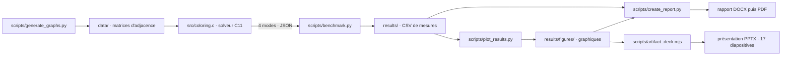
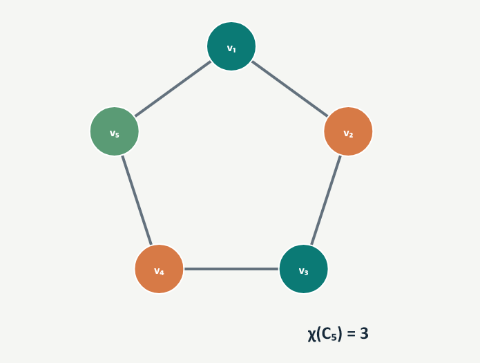
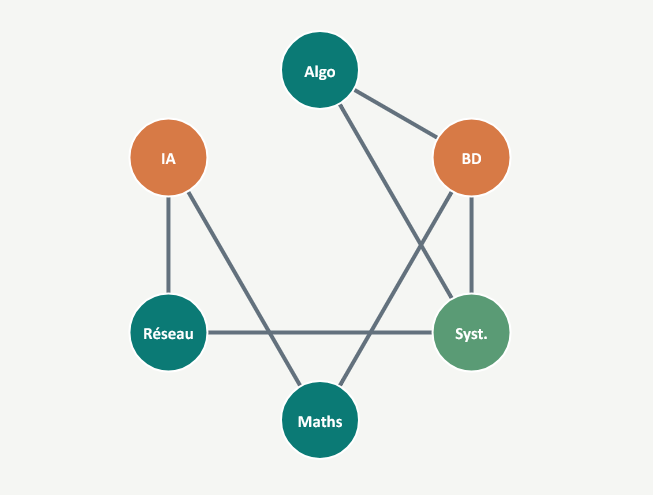
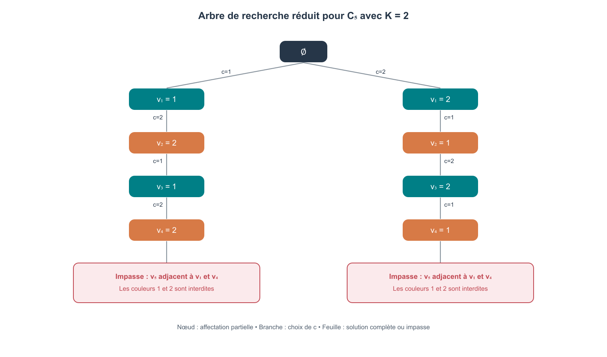
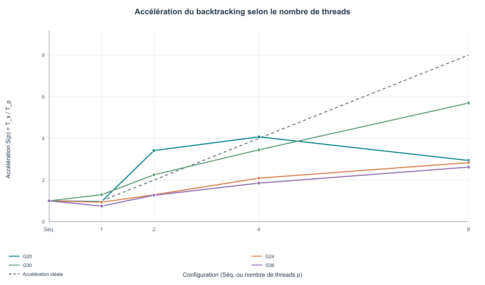
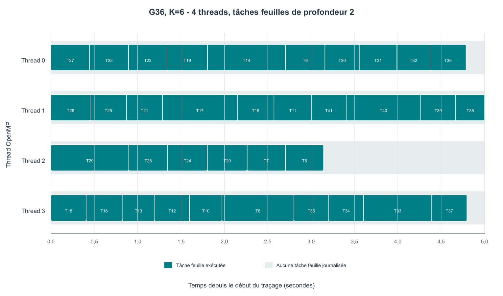

# Coloriage de graphes
### Projet C11 · OpenMP · complexité algorithmique


**Équipe : Zied Chouk · Chayma Hakouna · Wirak**

Projet universitaire qui compare quatre façons de colorier un graphe : glouton séquentiel et OpenMP, recherche exacte séquentielle et OpenMP. Le dépôt contient le code C, les entrées, les mesures, les figures et les livrables.

> Le glouton trouve rapidement une coloration valide et fournit une borne supérieure. Le backtracking essaie les nombres de couleurs croissants et certifie le nombre chromatique.

## Parcours du dépôt



## Aperçu des résultats

Le cycle impair C5 a besoin de trois couleurs. La figure montre une coloration propre qui atteint cette borne :



Le même modèle transforme les conflits entre examens en créneaux compatibles :



Pour comprendre pourquoi deux couleurs échouent sur C₅, l’arbre réduit montre les deux branches possibles et l’impasse au cinquième sommet :



L'accélération du backtracking compare le temps séquentiel au temps OpenMP selon le nombre de threads p :



La trace Gantt est produite séparément des mesures chronométrées :



## Démarrage rapide

### Prérequis

- GCC avec OpenMP. Sous Windows, installez un GCC MinGW-w64 (par exemple MSYS2) avec son dossier bin dans PATH. WSL peut suivre les commandes Linux.
- Git pour cloner le dépôt.
- Python 3 pour les tests, benchmarks, figures et rapport.
- Les bibliothèques utilisées pour les figures et le rapport :

```bash
python -m pip install matplotlib python-docx Pillow
```

Le solveur C n'utilise pas de bibliothèque tierce hors runtime OpenMP de GCC. Le générateur JavaScript facultatif scripts/plot_results.mjs requiert Node.js et sharp : npm install --no-save --package-lock=false sharp.

### 1. Vérifier GCC et OpenMP

```text
gcc --version
```

La compilation avec -fopenmp à l'étape suivante valide aussi l'activation et l'édition de liens OpenMP. En cas de message « unrecognized command-line option » ou « cannot find -lgomp », installez une distribution GCC avec OpenMP.

### 2. Compiler

#### Windows PowerShell

```powershell
New-Item -ItemType Directory -Force build | Out-Null
gcc -O2 -std=c11 -Wall -Wextra -Wpedantic -fopenmp src/coloring.c -o build/coloring.exe -fopenmp
```

#### Windows CMD

```bat
if not exist build mkdir build
gcc -O2 -std=c11 -Wall -Wextra -Wpedantic -fopenmp src/coloring.c -o build\coloring.exe -fopenmp
```

#### Linux / WSL

```bash
mkdir -p build
gcc -O2 -std=c11 -Wall -Wextra -Wpedantic -fopenmp src/coloring.c -o build/coloring -fopenmp
```

- -std=c11 sélectionne C11, -O2 active l'optimisation et -fopenmp active OpenMP.
- Les autres options demandent à GCC d'afficher des avertissements utiles.
- Le binaire reste dans build/, ignoré par Git.

### 3. Démonstration jury en moins de 90 secondes

Compilez avant la soutenance. G20 est inclus dans Git : aucune génération de données n'est requise. Lancez les trois résolutions dans cet ordre.

**PowerShell :**

```powershell
.\build\coloring.exe data\examples\cycle5.txt exact-seq
.\build\coloring.exe data\generated\exact\g20.txt exact-seq --warmup 1 --repeat 3 --batch 10
.\build\coloring.exe data\generated\exact\g20.txt exact-omp --threads 4 --task-depth 4 --warmup 1 --repeat 3 --batch 10
```

**Windows CMD :**

```bat
build\coloring.exe data\examples\cycle5.txt exact-seq
build\coloring.exe data\generated\exact\g20.txt exact-seq --warmup 1 --repeat 3 --batch 10
build\coloring.exe data\generated\exact\g20.txt exact-omp --threads 4 --task-depth 4 --warmup 1 --repeat 3 --batch 10
```

**Linux / WSL :**

```bash
./build/coloring data/examples/cycle5.txt exact-seq
./build/coloring data/generated/exact/g20.txt exact-seq --warmup 1 --repeat 3 --batch 10
./build/coloring data/generated/exact/g20.txt exact-omp --threads 4 --task-depth 4 --warmup 1 --repeat 3 --batch 10
```

Le programme émet un objet JSON par commande. Vérifiez ces champs dans la sortie complète :

| Cas | Valeurs attendues |
| --- | --- |
| C5 séquentiel | vertices=5, edges=5, chromatic_number=3, solution_valid=true, couleurs=[1,2,1,2,3] |
| G20 séquentiel | vertices=20, edges=91, chromatic_number=5, solution_valid=true |
| G20 OpenMP | chromatic_number=5, solution_valid=true, threads=4, task_depth=4 |

Les temps de référence archivés pour G20 sont environ 6,76 ms en séquentiel et 1,66 ms à quatre threads. Les temps en direct dépendent de la machine et de sa charge. Le résultat de correction doit rester le même.

Voici le format JSON et les champs à repérer. L’ordre des couleurs peut varier entre les exécutions exactes parallèles; elles doivent toujours décrire une coloration valide de 5 couleurs. Les durées sont des exemples et ne sont pas des objectifs à garantir.

```json
{"mode":"exact-seq","vertices":5,"edges":5,"chromatic_number":3,"solution_valid":true,"colors":[1,2,1,2,3],"seconds":[0.000000000],"threads":1,"task_depth":4,"batch":1}
{"mode":"exact-seq","vertices":20,"edges":91,"chromatic_number":5,"solution_valid":true,"colors":[1,2,3,4,3,4,1,3,3,4,4,1,5,2,3,5,2,1,5,2],"seconds":[0.005099988,0.006299996,0.006400013],"threads":1,"task_depth":4,"batch":10}
{"mode":"exact-omp","vertices":20,"edges":91,"chromatic_number":5,"solution_valid":true,"colors":[2,5,4,3,4,3,2,4,4,3,3,2,1,5,4,1,5,2,1,5],"seconds":[0.000000000,0.001600003,0.001600003],"threads":4,"task_depth":4,"batch":10}
```

Les deux lignes G20 sont un exemple capturé sur la machine de préparation. Les champs `colors` et `seconds` sont sensibles à l’ordonnancement et à la machine; les valeurs à comparer sont notamment `vertices`, `edges`, `chromatic_number` et `solution_valid`.

## Le modèle en une minute

Un graphe non orienté est G=(V,E). Un sommet représente un objet, une arête représente une incompatibilité et une couleur représente une ressource ou un créneau. Une coloration propre attribue des couleurs différentes aux extrémités de chaque arête. Le nombre chromatique χ(G) est le minimum de couleurs requis.

- greedy-seq et greedy-omp produisent une coloration propre dans l'ordre des sommets du fichier. Leur nombre de couleurs est une borne supérieure de χ(G), pas une preuve de minimalité.
- exact-seq et exact-omp essaient K=1,2,… jusqu'à la première coloration valide. Le premier succès certifie χ(G).
- Avec une matrice, chaque algorithme balaie jusqu'à n cases pour chacun des n sommets. Le glouton est donc Θ(n²), même si m=0.
- La décision « le graphe est-il 3-coloriable ? » est NP-complète en général. Le backtracking peut avoir un arbre exponentiel; il vise ici des graphes de taille modérée.

## Interface en ligne de commande

Syntaxe : PROGRAMME FICHIER_GRAPHE MODE [options]. Le fichier commence par n puis contient exactement n² chiffres 0 ou 1, séparés par des espaces ou retours à la ligne. La matrice doit être symétrique et sa diagonale nulle. Le graphe vide est représenté par un fichier contenant 0.

| Mode ou option | Valeurs / défaut | Effet et exemple |
| --- | --- | --- |
| `greedy-seq` | Mode requis | Glouton séquentiel dans l'ordre d'entrée. Exemple : `build/coloring.exe data/examples/cycle5.txt greedy-seq`. |
| `greedy-omp` | Mode requis | Même ordre des sommets; parallélise le balayage d’une ligne. Exemple : `greedy-omp --threads 4`. |
| `exact-seq` | Mode requis | Recherche séquentielle exacte du nombre chromatique. Exemple : `exact-seq`. |
| `exact-omp` | Mode requis | Recherche exacte avec tâches OpenMP. Exemple : `exact-omp --threads 4 --task-depth 4`. |
| `--threads N` | 1–256, défaut 1 | Équipe OpenMP demandée; utile aux modes `*-omp`. Exemple : `--threads 4`. |
| `--task-depth N` | 1–4, défaut 4 | Profondeur maximale de création de tâches pour `exact-omp`; les branches au-delà continuent récursivement. Exemple : `--task-depth 2`. |
| `--k K` | Entier positif, sans défaut | Modes exacts seulement : décide si le graphe est coloriable en au plus K couleurs. Exemple : `exact-seq --k 2`. |
| `--warmup N` | 0–20, défaut 0 | Nombre de lots d’échauffement non chronométrés. Exemple : `--warmup 1`. |
| `--repeat N` | 1–100, défaut 1 | Nombre de mesures; `seconds` contient une durée moyenne par résolution pour chaque répétition. Exemple : `--repeat 5`. |
| `--batch N` | 1–1 000 000, défaut 1 | Résolutions dans chaque mesure; la durée totale est divisée par N. Exemple : `--batch 10`. |
| `--gantt CSV` | Sans défaut | Écrit une trace séparée avec `exact-omp`; interdit avec `--k`. Exemple : `--gantt results/gantt_4threads.csv`. |

**Attention aux noms exacts :** le code reconnaît `--gantt`, pas `--trace-gantt`. Il n’existe pas de drapeau `--help`; si les arguments manquent ou sont invalides, le programme affiche son usage sur stderr.

### Exemple de décision

C5 est impossible à colorier avec deux couleurs :

```bash
./build/coloring data/examples/cycle5.txt exact-seq --k 2
```

La réponse comprend colorable=false. Avec un K faisable, le JSON contient colorable=true et les couleurs correspondantes. En mode glouton, le champ JSON chromatic_number contient seulement le nombre de couleurs utilisées par l'heuristique; ne le présentez pas comme un optimum certifié.

### Lire la sortie JSON

- mode, vertices et edges décrivent l'exécution.
- Pour une recherche exacte du minimum, chromatic_number est optimal. Pour le glouton, c'est le nombre de couleurs de sa solution.
- En mode --k, l'information de décision apparaît dans k, colorable, solution_valid et colors.
- seconds contient une durée moyenne par résolution, en secondes; quand batch > 1, le temps du lot est divisé par batch.
- threads, task_depth et batch rappellent les paramètres.

Les erreurs vont sur stderr et s'accompagnent d'un code de retour non nul.

## Tests et expériences

Après compilation, exécutez les tests de correction :

```bash
python tests/test_color.py
```

Les tests couvrent notamment le graphe vide, un singleton, un graphe sans arêtes, les bipartis, les cycles impairs, les graphes complets et les graphes déconnectés. Ils comparent aussi les versions séquentielles et OpenMP.

Le générateur produit les familles déterministes, puis le benchmark calibre les graphes exacts et mesure les mêmes instances avec 1, 2, 4 et 8 threads :

```bash
python scripts/generate_graphs.py
python scripts/benchmark.py
python scripts/plot_results.py
```

Le pilote retient les quatre plus grandes tailles exactes résolues sous 60 secondes. Les mesures brutes sont écrites dans results/raw_measurements.csv; les moyennes, écarts-types, speedup et efficacité sont dans results/performance_summary.csv. Cette campagne peut prendre plusieurs minutes.

Pour régénérer les figures à partir des CSV déjà disponibles, sans refaire les mesures, exécutez seulement :

```bash
python scripts/plot_results.py
```

Les commandes de traçage Gantt après génération de G36 sont :

```powershell
.\build\coloring.exe data\generated\exact\g36.txt exact-omp --threads 2 --task-depth 2 --gantt results\gantt_2threads.csv
.\build\coloring.exe data\generated\exact\g36.txt exact-omp --threads 4 --task-depth 2 --gantt results\gantt_4threads.csv
python scripts/plot_results.py
```

Le traçage lance une résolution séparée après la mesure. La variante Gantt utilise une profondeur de tâches 2 pour tracer les sous-arbres feuilles, sans ajouter l'instrumentation aux temps de performance.

## Refaire les livrables

- **Rapport DOCX :** installez les dépendances Python et régénérez les figures à partir des CSV. Exportez ensuite les diapositives 3 et 10 de la présentation en PNG vers `results/slides/slide-03.png` et `results/slides/slide-10.png`, puis générez le rapport :

  ```bash
  python scripts/plot_results.py
  python scripts/create_report.py
  ```

  `create_report.py` écrit `rapport_coloriage_graphes.docx` à la racine. Pour remplacer le PDF livré, exportez ce DOCX en PDF avec votre éditeur de documents et placez le résultat dans `deliverables/rapport_coloriage_graphes.pdf`.
- **Présentation PPTX :** le deck de 17 diapositives est défini par `scripts/artifact_deck.mjs` dans la session Artifact du projet; ce fichier n’est pas un exporteur local autonome. Ouvrez la source dans cette session, exportez le PPTX vers `deliverables/presentation_coloriage_graphes.pptx`, puis appliquez les métadonnées :

  ```bash
  python scripts/set_pptx_metadata.py deliverables/presentation_coloriage_graphes.pptx
  ```

## Carte des fichiers suivis

```text
.
├── .gitignore                                  # Binaries, caches, traces et graphes volumineux ignorés
├── GUIDE_SOUTENANCE_EQUIPE.md                 # Cours visuel et playbook de défense
├── Makefile                                    # Compilation et raccourcis make test/graphs/benchmark
├── README.md                                   # Présente le projet et les commandes de démarrage
├── rapport_coloriage_graphes.docx              # Rapport modifiable
├── data/
│   ├── examples/
│   │   ├── cycle5.txt                          # Cycle impair à 5 sommets
│   │   ├── exam_schedule.txt                   # Matrice de 6 examens
│   │   └── exam_schedule_labels.json           # Signification des sommets
│   └── generated/exact/g20.txt                 # Graphe G20 déterministe suivi par Git
├── deliverables/
│   ├── presentation_coloriage_graphes.pptx     # Deck modifiable de 17 slides
│   └── rapport_coloriage_graphes.pdf           # Rapport final
├── results/
│   ├── exact_selection.json                    # Instances exactes retenues aux mesures
│   ├── figures/
│   │   ├── arbre_backtracking_c5_k2.png         # Échec de 2-coloration sur C5
│   │   ├── cycle5_colore.png                    # C5 colorié en 3 couleurs
│   │   ├── efficacite_exact.png                 # Efficacité du backtracking
│   │   ├── efficacite_greedy.png                # Efficacité du glouton
│   │   ├── exam_schedule.png                    # Conflits et créneaux d'examens
│   │   ├── gantt_2threads.png                  # Tâches feuilles, 2 threads
│   │   ├── gantt_4threads.png                  # Tâches feuilles, 4 threads
│   │   ├── gantt_openmp.png                    # Vue Gantt synthétique, 4 threads
│   │   ├── speedup_exact.png                   # Accélération du backtracking
│   │   ├── speedup_greedy.png                  # Accélération du glouton
│   │   ├── taille_exact.png                    # Temps exact selon n
│   │   ├── taille_greedy.png                   # Temps glouton selon n
│   │   ├── temps_taille.png                   # Ancienne vue combinée des temps
│   │   ├── temps_threads_exact.png             # Temps exact selon les threads
│   │   └── temps_threads_greedy.png            # Temps glouton selon les threads
│   ├── gantt.csv                               # Trace de référence
│   ├── gantt_2threads.csv                      # Événements de la trace à 2 threads
│   ├── gantt_4threads.csv                      # Événements de la trace à 4 threads
│   ├── performance_summary.csv                # Moyennes, écarts-types, speedup et efficacité
│   └── raw_measurements.csv                   # Mesures répétées brutes
├── scripts/
│   ├── artifact_deck.mjs                       # Source du deck Artifact
│   ├── benchmark.py                            # Calibrage et mesures
│   ├── build.ps1                               # Compilation Windows
│   ├── create_report.py                        # Génération du DOCX
│   ├── generate_graphs.py                      # Entrées déterministes
│   ├── plot_results.mjs                        # Figures facultatives via sharp
│   ├── plot_results.py                         # Figures Python à partir des CSV
│   ├── run_all.ps1                             # Pipeline complet Windows
│   └── set_pptx_metadata.py                    # Métadonnées PPTX
├── src/
│   └── coloring.c                              # Chargement, validation et quatre modes
└── tests/
    └── test_color.py                           # Vérifications de correction
```

Le graphe G20 est suivi par Git pour que la démo fonctionne sans génération préalable. Les autres entrées générées (G12, G16, G24, G30, G36 et les graphes gloutons) sont recréées par `scripts/generate_graphs.py` et ignorées par Git. `build/` contient le binaire compilé et `tmp/` sert aux fichiers temporaires locaux; ces répertoires ignorés ne sont pas des sources du dépôt.

## Pipeline Windows

scripts/run_all.ps1 automatise la compilation, les tests, la génération des graphes, la campagne complète, les traces Gantt et les figures. Il peut prendre plusieurs minutes. Depuis PowerShell :

```powershell
.\scripts\run_all.ps1
```

Pour un aperçu du raisonnement, une carte fonction par fonction, les charts expliqués, une répartition équitable de la soutenance et quinze Q&R, ouvrez GUIDE_SOUTENANCE_EQUIPE.md.
